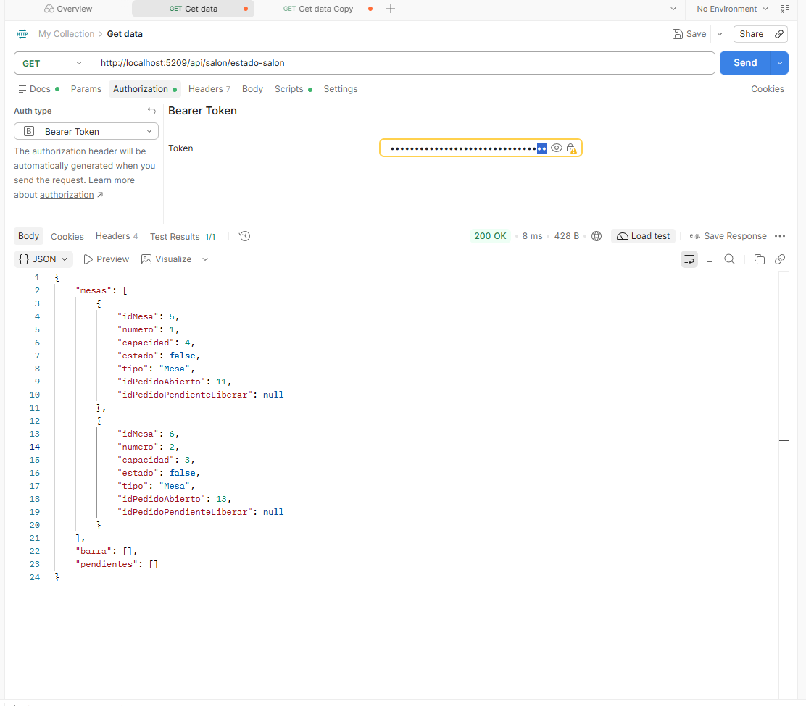
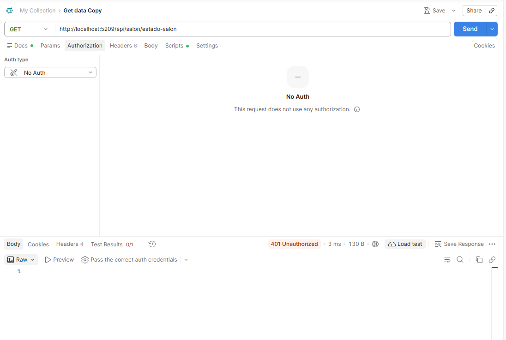

# 🍽️ Foodly — Sistema de Gestión Gastronómica

Proyecto Integrador Final — **Laboratorio II** (Desarrollo de Software, ULP)
Integrantes: Pascual · Leyes · De la Hoz · Clavero

Sistema web para la gestión operativa de un restaurante/bar: inventario de insumos, compras a proveedores, carta de platos con recetas, control del salón y comanda digital para mozos con descuento automático de stock.

---

## 📌 Problema que resuelve

En un restaurante, el stock de insumos, los pedidos de las mesas y la facturación suelen manejarse por separado (papel, planillas, memoria del mozo). Eso genera platos vendidos sin insumos disponibles, mesas mal cobradas y ninguna información confiable de qué se vende ni cuánto se gasta.

Foodly centraliza todo el circuito:

- **Compras → Stock:** cada compra a proveedor suma insumos al inventario.
- **Recetas:** cada plato se define por los insumos y cantidades que consume (`detalle_receta`).
- **Pedidos → Stock:** al cargar un plato en una comanda, el sistema verifica que alcancen los insumos de su receta y los descuenta dentro de una **transacción** (commit si hay stock, rollback si falta).
- **Salón:** estado de mesas y barra (Libre/Ocupada) y pedidos pendientes ordenados por tiempo de espera.
- **Cierre:** cálculo automático del total del pedido y liberación de la mesa.
- **Informes:** balance, platos más vendidos, compras por proveedor y ventas por mozo.

---

## 🧱 Stack

| Capa | Tecnología |
|---|---|
| Backend | ASP.NET Core MVC + Web API (.NET 10, C#) |
| Persistencia | MySQL / MariaDB (InnoDB) con Entity Framework Core 9 + Pomelo |
| Frontend | Vistas Razor + Bootstrap 5 · SPA de comanda en **Vue 3** |
| Seguridad | Cookies (sitio MVC) + **JWT Bearer** (API consumida por la SPA) · contraseñas con `PasswordHasher` |

---

## 👥 Roles y credenciales de prueba

| Rol | Usuario | Contraseña | Acceso principal |
|---|---|---|---|
| **Administrador** | `admin_1` | `Foodly2026` | `/Home/Index` — panel de gestión MVC |
| **Mozo** | `homero` | `Foodly2026` | `/SPA/Index` — terminal de comanda (Vue) |

Otros mozos de prueba con la misma contraseña: `lucia_f`, `tomas_b`, `camila_o`, `diego_m`.

**Restricción por rol:**
- Solo el **Administrador** gestiona productos, proveedores, compras, empleados, usuarios, informes y el alta/edición/baja de platos.
- Solo el **Mozo** accede a la SPA de comanda y a la Web API (`/api/*`), protegida con `[Authorize(AuthenticationSchemes = JwtBearer, Roles = Mozo)]`.

---

## 🗂️ Modelo de datos

13 tablas: `rol`, `usuario`, `empleado`, `mesa`, `categoria`, `plato`, `producto`, `detalle_receta`, `proveedor`, `compra`, `detalle_compra`, `pedido`, `detalle_pedido`.

| Tipo de relación | Ejemplos |
|---|---|
| **1:N** | Categoría → Platos · Mesa → Pedidos · Rol → Usuarios · Proveedor → Compras |
| **N:M** (con tabla intermedia) | Plato ↔ Producto vía `detalle_receta` · Pedido ↔ Plato vía `detalle_pedido` · Compra ↔ Producto vía `detalle_compra` |
| **Entidad que depende de otras dos** | `pedido` → `mesa` + `empleado` (mozo) |


Script con estructura y datos de prueba: [`DataBase/sistema_gastronomico.sql`](DataBase/sistema_gastronomico.sql)

---

## 📋 Matriz de Evidencias de Requerimientos Mínimos

| Requerimiento Mínimo | Estado | Enlace al Código / Controladores | Evidencia |
|---|---|---|---|
| **1. 6+ tablas, relación 1:N y N:M** | ✅ Cumplido | [GastronomiaContext.cs](Models/GastronomiaContext.cs#L12-L43) · [sistema_gastronomico.sql](DataBase/sistema_gastronomico.sql) |  |
| **2. Login/Logout, roles y avatar** | ✅ Cumplido | [LoginController.cs](Controllers/LoginController.cs#L43-L106) · [RolesSistema.cs](Models/RolesSistema.cs) · [UsuarioController.cs — Perfil/avatar](Controllers/UsuarioController.cs#L277-L325) |  |
| **3. Manejo de archivos (extra al avatar)** | ✅ Cumplido | [PlatoController.cs — ProcesarImagenLocal](Controllers/PlatoController.cs#L391-L413) (imágenes de platos en `wwwroot/img/platos/`) |  |
| **4. ABM en Vue.js + AJAX** | ✅ Cumplido | [Views/SPA/Index.cshtml](Views/SPA/Index.cshtml#L119) · [PedidoApiController.cs](Api/PedidoApiController.cs) — Alta (`POST /api/pedidos/alta`), Listado (`GET /api/pedidos/{id}`), Modificación (`PUT /api/pedidos/detalle/{id}`), Baja (`DELETE /api/pedidos/detalle/{id}` y `DELETE /api/pedidos/{id}`) |  |
| **5. Paginado por servidor** | ✅ Cumplido | [ProductoController.cs](Controllers/ProductoController.cs#L22-L32) · [RepositorioProducto.cs](Models/RepositorioProducto.cs#L53) (`Skip/Take`). Mismo esquema en Platos, Pedidos, Compras, Proveedores, Empleados y Usuarios |  |
| **6. Selección asíncrona (AJAX)** | ✅ Cumplido | [platoReceta.js](wwwroot/js/platoReceta.js#L24) → [ProductoController.BuscarTexto](Controllers/ProductoController.cs#L93) (insumos al armar recetas y compras) · [buscarPlato.js](wwwroot/js/buscarPlato.js) → [PlatoController.BuscarPlato](Controllers/PlatoController.cs#L420) (platos al cargar pedidos) |  |
| **7. Web API REST + JWT** | ✅ Cumplido | [ServicioJwt.cs](Services/ServicioJwt.cs#L19) · [Program.cs](Program.cs) (esquema JwtBearer) · [Api/](Api/) (`MesaApiController`, `PedidoApiController`, `PlatoApiController`) | Con token (200):  Sin token (401):  |

> **Sobre la colección de Postman:** la Web API es consumida de forma nativa por la SPA del mozo. Al ingresar a `/SPA/Index`, [`SPAController`](Controllers/SPAController.cs#L30) genera el JWT y la app Vue lo envía como `Authorization: Bearer <token>` en cada `fetch`. Las capturas de Postman se incluyen solo como evidencia de la protección (200 con token / 401 sin token).

---

## 🔄 Descuento transaccional de stock

Al agregar un plato a un pedido ([RepositorioDetallePedido.Alta](Models/RepositorioDetallePedido.cs#L18-L60)):

1. Se abre una transacción (`BeginTransaction`).
2. Se valida que el pedido esté abierto y el plato activo.
3. Se calcula cuántas porciones permiten los insumos de la receta; si no alcanza, se lanza una excepción indicando el insumo faltante → **rollback**.
4. Se registra el detalle, se descuentan los insumos y se recalcula el total del pedido → **commit**.

Las compras ([RepositorioCompra.cs](Models/RepositorioCompra.cs)) usan el mismo patrón para sumar stock de forma atómica.

---

## 🛠️ Estructura del proyecto

```
Api/           Endpoints REST protegidos con JWT (salón, pedidos, platos)
Controllers/   Controladores MVC (Productos, Platos, Compras, Pedidos, Mesas, Usuarios, Informes, Login, SPA)
DataBase/      Script SQL con estructura y datos de prueba
Helpers/       Claims de identidad, carga de avatar y validaciones
Models/        Entidades, DbContext, repositorios y DTOs de informes
Services/      Generación de tokens JWT
Views/         Vistas Razor y módulo SPA (Views/SPA)
wwwroot/       Estáticos: JS, CSS, imágenes de platos y avatares subidos
docs/          Diagrama ER y evidencias
```

---

## 🚀 Ejecución local

**Requisitos:** .NET 10 SDK · MySQL 8 o MariaDB.

1. Clonar el repositorio:
   ```bash
   git clone https://github.com/patricioPascual/sistema_gastronomico_pascual_leyes_delahoz_clavero.git
   cd sistema_gastronomico_pascual_leyes_delahoz_clavero
   ```
2. Importar la base de datos (crea `sistema_gastronomico` con datos de prueba):
   ```bash
   mysql -u root -p < DataBase/sistema_gastronomico.sql
   ```
3. Configurar la conexión y la clave JWT: copiar `appsettings.example.json` como `appsettings.Development.json` (ignorado por git) y completar `ConnectionStrings:MySql` y `TokenAuthentication:SecretKey` (mínimo 32 caracteres).
4. Ejecutar:
   ```bash
   dotnet run
   ```
5. Abrir `http://localhost:5209` e ingresar con alguna de las credenciales de prueba.
