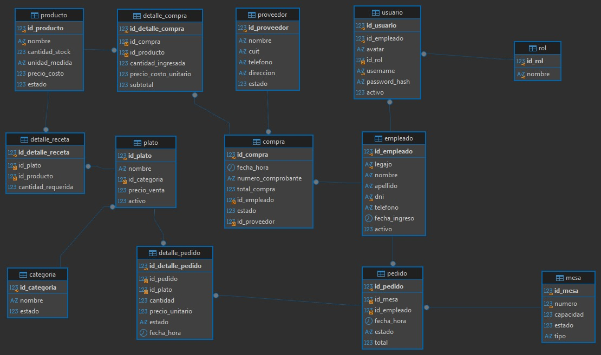
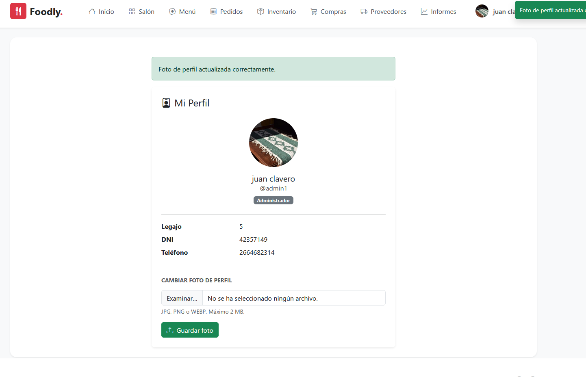
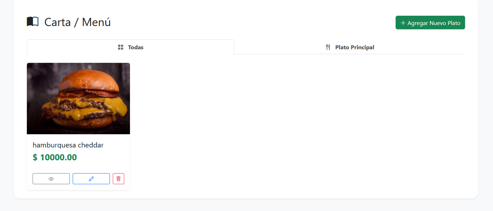
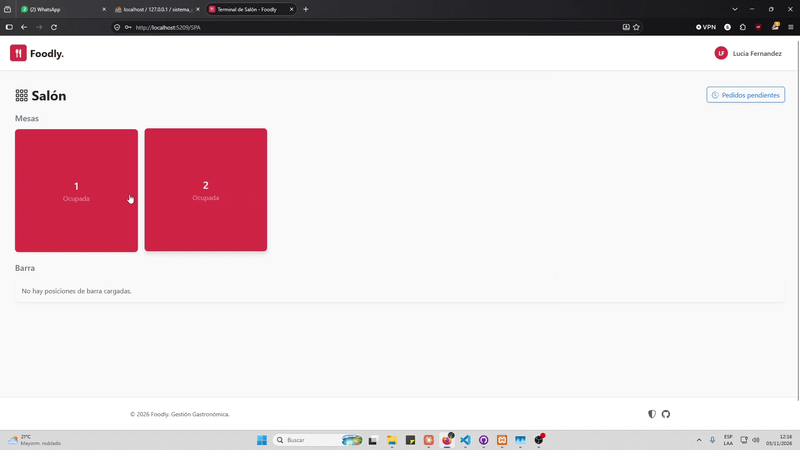
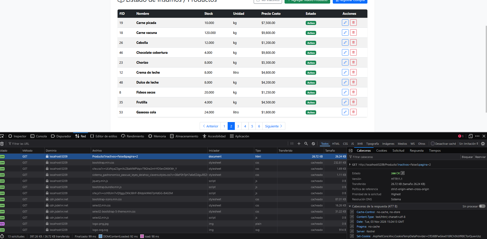
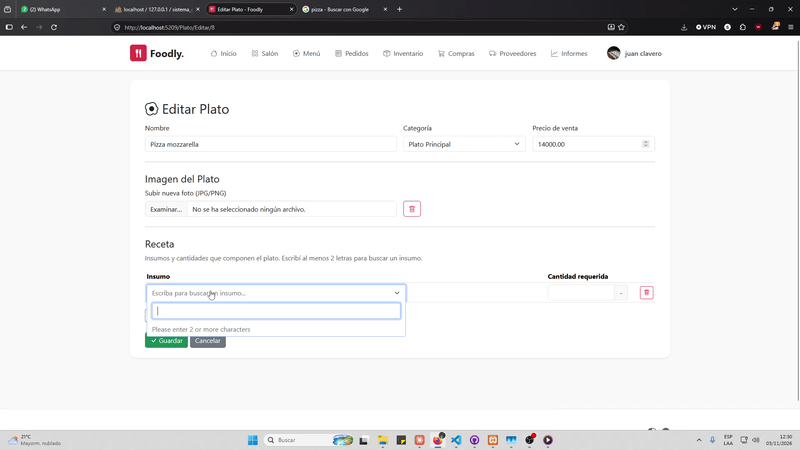

# sistema_gastronomico_pascual_leyes_delahoz_clavero
# 🍽️ Foodly - Sistema Gastronómico de Gestión y Comandas

Sistema web integral desarrollado en **ASP.NET Core MVC** y **Vue.js** diseñado para la gestión operativa de restaurantes, administración de insumos/productos, platos, recetas y comanda digital para mozos en tiempo real.

---

## 📌 Descripción del Proyecto
El proyecto resuelve la problemática de la gestión gastronómica centralizando:
- Administración de stock de insumos, proveedores, compras y recetas de platos.
- Control de usuarios y roles (Administrador, Recepción, Mozo) con autenticación basada en cookies y JWT.
- Terminal de comanda interactiva (SPA) para mozos mediante el consumo de una Web API REST autenticada con JWT.
- Informes y estadísticas de ventas y stock.

---

## 👥 Credenciales de Prueba (Para Evaluación)

| Rol                | Usuario | Contraseña | Acceso Principal |
|---|---|---|---|
| **Administrador** | `Administrador` | `admin2026` | `/Home/Index` (Dashboard MVC) |
| **Mozo** | `Homero` | `homerosimpson` | `/SPA/Index` (Terminal Vue.js) |

---
Markdown
## 📋 Matriz de Evidencias de Requerimientos Mínimos

| Requerimiento Mínimo | Estado | Enlace al Código / Controladores | Evidencia (Captura / GIF / Video) |
|---|---|---|---|
| **1. 6+ Tablas y Relación 1:N / N:M** | ✅ Cumplido | [GastronomiaContext.cs](Models/GastronomiaContext.cs) | Diagrama DER y script en /DataBase/sistema_gastronomico.sql<br> |
| **2. Login, Roles y Avatar** | ✅ Cumplido | [LoginController.cs](Controllers/LoginController.cs) |  |
| **3. Manejo de Archivos (Extra)** | ✅ Cumplido | [PlatoController.cs](Controllers/PlatoController.cs) |  |
| **4. ABM en Vue.js + AJAX** | ✅ Cumplido | [SPAController.cs](Controllers/SPAController.cs) |  |
| **5. Paginado por Servidor** | ✅ Cumplido | [ProductoController.cs](Controllers/ProductoController.cs) |  |
| **6. Selección Asíncrona (AJAX)** | ✅ Cumplido | [buscarPlato.js](wwwroot/js/buscarPlato.js) |  |
| **7. Web API + JWT** | ✅ Cumplido | [ServicioJwt.cs](Services/ServicioJwt.cs) | Captura de Postman con Bearer Token consumiendo /Api/ |

## 🛠️ Estructura del Proyecto

- **/Api**: Endpoints REST con autenticación JWT (`MesaApiController`, `PedidoApiController`, `PlatoApiController`).
- **/Controllers**: Controladores MVC para administración general (Productos, Platos, Compras, Pedidos, Usuarios, Informes).
- **/DataBase**: Script de base de datos MySQL/MariaDB con datos de prueba (`sistema_gastronomico.sql`).
- **/Helpers**: Componentes auxiliares para Claims de identidad y carga de avatares (`AvatarHelper.cs`, `ClaimsHelper.cs`).
- **/Models**: Entidades del sistema y repositorios de persistencia.
- **/Services**: Servicio de generación y validación de tokens JWT (`ServicioJwt.cs`).
- **/Views**: Vistas Razor renderizadas en el servidor y módulos SPA (`Views/SPA/`).
- **/wwwroot**: Archivos estáticos, scripts JS, imágenes de platos y avatares subidos (`/uploads/avatars/`).

---

## 🚀 Instrucciones de Ejecución Local

1. **Clonar el repositorio:**
   ```bash
   git clone [https://github.com/patricioPascual/sistema_gastronomico_pascual_leyes_delahoz_clavero.git](https://github.com/patricioPascual/sistema_gastronomico_pascual_leyes_delahoz_clavero.git)
